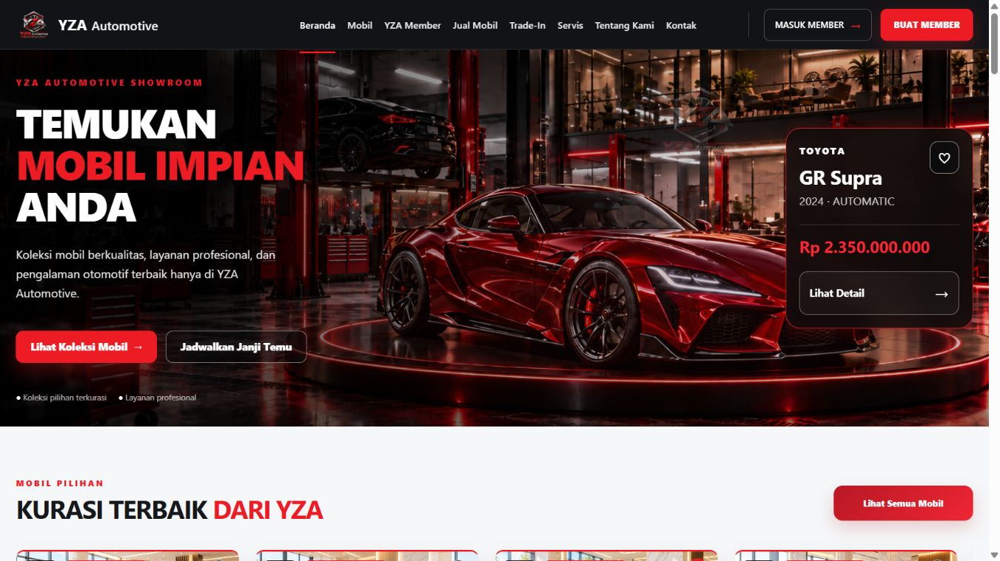
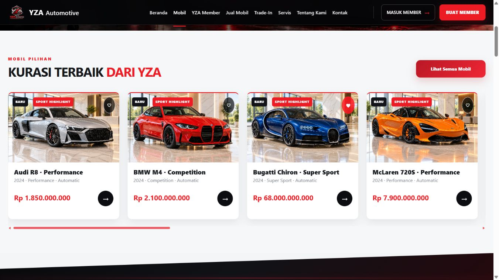

# YZA Automotive — Global Compact Premium UI Refinement

Tanggal: **6 November 2026, Asia/Jakarta**. Baseline: browser zoom **100%**, terutama **1366×768**. Project: `C:\xampp\htdocs\yza_automotive_laravel`.

## 1. Kondisi UI sebelum perbaikan

Tahap ini melanjutkan [laporan responsif sebelumnya](YZA_GLOBAL_RESPONSIVE_100_PERCENT_REPORT.md) dan [checklist UAT existing](responsive-100/MANUAL_UAT_CHECKLIST.md), tanpa memulai ulang desain. Layout sudah memiliki foundation responsif, tetapi densitas masih terlalu longgar. Bukti lama tidak dianggap sebagai visual PASS untuk tahap compact.

Pengukuran browser lokal sebelum refinement pada 1366×768 menunjukkan navbar 72 px, hero 696 px, judul hero 71,05 px, CTA 58 px, panel kendaraan 320 px, foto katalog 280 px dan kartu katalog sekitar 467,30 px. Membership publik masih setinggi 872,67 px, dengan heading 64,22 px dan kartu sekitar 433,83 px. Angka ini berasal dari DOM aktual, bukan perkiraan screenshot.

Branch tetap `feature/vehicle-purchase-flow`; HEAD tetap `0359b1e8fa28aeceac5aa8491bb7eb5d85672ea6`. Working tree sudah dirty sebelum tugas ini. [Status sebelum](compact-100/git-status-before.txt) dan status akhir disimpan; perubahan P0/Owner/admin sebelumnya dipertahankan. Tidak ada reset, clean, checkout paksa, commit, push, atau deployment.

## 2. Penyebab komponen terlalu besar

- Banyak stylesheet area masih memiliki ukuran lama: tombol hero 58 px, heading checkout hingga 62 px, heading detail hingga 6,5rem, padding lebar dan minimum tinggi kartu yang berlebihan.
- Foundation sebelumnya lebih banyak menangani `.member-center-dashboard`; varian aktif `.yza-home` masih memiliki aturan hero dan kartu sendiri. Mengubah selector dashboard lain tidak menyelesaikan varian ini.
- Kartu member memiliki tinggi alami dari logo, margin label, rule dan footer. Menurunkan `min-height` saja tidak cukup; spacing internal juga perlu dipadatkan.
- Membership publik memakai lima line break pada heading, minimum tinggi section setara viewport, kartu lebar dan ikon/benefit besar.
- Aturan `flex` tambahan untuk native carousel menimpa breakpoint jumlah kartu. Ini membuat empat kartu tetap sempit di tablet.
- `.show-container` berbasis 96vw sedikit lebih lebar daripada area dokumen dengan scrollbar pada 320 px.
- Stylesheet admin mempunyai penutup kurung yang tidak berpasangan di sekitar filter mobile. Filter tersebut keluar dari media query dan berlaku juga pada desktop.
- Register mobile masih memiliki panel dekoratif minimum **620 px**, walaupun copy di dalamnya disembunyikan. Form tertunda jauh ke bawah layar.
- Lapisan CSS area dan inline stylesheet dapat lebih spesifik daripada foundation. Refinement dilakukan pada aturan sumber yang ditemukan, bukan menambahkan stylesheet override baru.

## 3. Perubahan ukuran global/shared

Foundation yang sudah ada disunting langsung. Tidak dipasang CSS zoom, transform scale pada root/container global, faktor pengali universal, `user-scalable=no`, atau body overflow masking baru.

| Token/komponen | Sebelum | Sesudah | Jenis bukti |
|---|---|---|---|
| Header shared | 4,5rem / 72 px | 4,25rem / 68 px | Source; navbar publik diukur 68 px |
| Sidebar | 15rem / 240 px | 14,75rem / 236 px | Source, bukan pengukuran live backoffice |
| Gutter | clamp 16–32 px | clamp 16–24 px | Source |
| Gap utama | clamp 12–20 px | clamp 12–16 px | Source |
| Maksimum konten | 94rem | 90rem / 1440 px | Source |
| Control touch | Minimum 44 px | Tetap minimum 44 px | Implementasi; input login diukur 46 px |
| KPI admin | Minimum 152 px pada foundation | Minimum 128 px | Source |
| Hero admin | Minimum 160 px, padding 24 px | Minimum 136 px, padding 20 px | Source |

Token tambahan menyatakan ukuran control, card padding, page title, body dan label. Ukuran komponen tetap ditentukan sesuai kebutuhannya. Fokus, drawer, local table scrolling, reduced motion dan struktur scroll dari tahap responsif tetap dipertahankan. Input/select backoffice/member pada mobile mendapat minimum target 44 px; textarea catatan panjang tidak diperkecil menjadi input satu baris.

## 4. Perubahan landing

Hero kini memakai heading fluid maksimum 56 px pada baseline, padding vertikal 32 px, dua kolom yang lebih efisien dan panel kendaraan lebih kecil. Tinggi hero baseline turun menjadi **516,14 px**. Background showroom dan mobil sport merah tetap sama; sumber kendaraan, harga dan tautan CTA tidak berubah.

CTA diukur **44 px**, dari 58 px. Panel kendaraan diukur sekitar **274,90 px**, dari 320 px, dengan padding 18 px. Logo/navbar tetap terbaca dan navbar diukur 68 px. Logo dekoratif tambahan di dalam hero disembunyikan pada layar kecil karena bertabrakan dengan teks; logo navigasi dan background kendaraan tetap tersedia.

Status: **IMPLEMENTED & VISUALLY VERIFIED** untuk viewport/state publik terpilih yang tercantum pada bagian 15. Ini tidak mengesahkan semua section, form atau state landing. Pada mobile hero boleh lebih tinggi karena greeting, CTA dan panel harga disusun vertikal; tidak dipaksa meniru tinggi desktop.

## 5. Perubahan katalog

Pada section `/#mobil`, foto menjadi 190 px dan padding informasi 16 px. Kartu pertama baseline diukur **348,85 px**, dari 467,30 px. Nama, metadata, harga, badge dan tombol detail tetap tersedia. Screenshot akhir memperlihatkan **empat kartu** di laptop 1366 px.

Aturan `flex` native carousel yang redundan dihapus sehingga breakpoint sumber kembali berlaku. Empat kartu digunakan bila ruang cukup, tiga pada rentang laptop sempit, dua pada tablet sampai 1100 px, dan satu pada ponsel sampai 650 px. Carousel tetap memiliki scrolling lokal dan urutan/data yang sama.

Halaman katalog penuh `/mobil` serta katalog member juga disunting pada inline stylesheet sumber: hero lebih pendek, judul fluid, nama kartu 17–18 px, padding lebih kecil, serta minimum tinggi body berlebihan diturunkan. Foto publik menggunakan rasio/contain yang menjaga bentuk kendaraan. Caption panjang tetap dapat membungkus.

Status: section katalog laptop **IMPLEMENTED & VISUALLY VERIFIED** untuk screenshot akhir; katalog penuh memiliki DOM lintas ukuran dan pemeriksaan visual awal, sedangkan filter, pagination, seluruh card dan katalog member **IMPLEMENTED — VISUAL NOT VERIFIED** secara menyeluruh.

## 6. Perubahan detail mobil

Detail BMW dibuka melalui tautan asli pada origin lokal yang sama. Heading diukur sekitar **45,09 px** pada 1366 px dan **30 px** pada 320 px. Source harga menggunakan clamp 24–30 px. Panel informasi menjadi padding 20 px; tombol utama minimum 46 px dan kelompok CTA sekunder minimum 48 px, menggantikan aturan 84 px. Label panjang tetap dapat membuat tombol lebih tinggi daripada minimum, sehingga teks tidak dipotong.

Thumbnail menjadi sekitar 72 px dan control galeri 44 px. Gambar tetap memakai sumber dan presentasi contain existing. Offset anchor mengikuti header shared; browser menunjukkan section yang dituju berada di bawah navbar. Tidak ada route pembelian, WhatsApp atau trade-in yang diubah.

Galeri mobile diuji: tombol **Foto berikutnya** mengubah counter menjadi **02 / 04**, tanpa overflow. Tautan WhatsApp tidak dibuka. Status viewport detail desktop/mobile terpilih: **IMPLEMENTED & VISUALLY VERIFIED**; seluruh galeri, spesifikasi bawah, modal dan alur bisnis tetap membutuhkan UAT tambahan.

## 7. Perubahan membership

Heading publik mempertahankan kata yang sama, dengan line break lebih efisien. Ukurannya diukur **45,09 px**, dari 64,22 px. Section menjadi **641,63 px**, dari 872,67 px. Kartu berukuran sekitar **261,53 px** tinggi, dari 433,83 px; angka merupakan bounding box browser, termasuk presentasi kartu existing.

Ikon benefit menjadi 40 px, padding benefit 16 px, teks benefit 13 px, dan CTA minimum 44 px. Seluruh enam benefit tetap tampil. Nominal aktivasi **Rp249.000** dan mekanisme aktivasi/Midtrans tidak diubah.

Halaman aktivasi/register juga mendapat ukuran heading, panel, padding dan tombol yang lebih proporsional. Login kini memiliki input 46 px dan heading desktop sekitar 34 px. Register mobile memiliki panel dekoratif 180 px, dari 620 px; card lebih lebar dan heading lebih ringkas. Form dan semua langkah pendaftaran dipertahankan, tanpa mengirim pendaftaran.

Status: membership publik baseline dan auth pada viewport terpilih **IMPLEMENTED & VISUALLY VERIFIED** untuk state yang terlihat; aktivasi berotorisasi dan seluruh langkah register **IMPLEMENTED — VISUAL NOT VERIFIED**.

## 8. Perubahan Member Center

Kedua varian dashboard ditangani: `.yza-home` pada `member-home.css` dan `.member-center-dashboard` pada Blade/foundation. Source greeting menjadi clamp sekitar 30–48 px; hero dan card padding dipadatkan; angka KPI menjadi 30 px; layanan menjadi sekitar minimum 190–192 px.

Kartu `.yza-home` tidak hanya diubah minimum tingginya. Logo menjadi 72×40 px, padding 18 px, margin label/rule/name dan footer diperkecil. Label ID, nama dan metadata tetap tersedia; label kecil justru dinaikkan menjadi 12 px. ID mempunyai font fluid dan tidak dipotong agar card terlihat ringkas. Background kendaraan dan desain kartu tetap sama.

Stats/gutter, kartu layanan, rekomendasi kendaraan, katalog member dan panel dashboard menggunakan spacing yang lebih efisien. Gate kepemilikan, status membership, poin dan promo tidak disentuh.

Status: **IMPLEMENTED — VISUAL NOT VERIFIED**. HTML fixture member berhasil dirender, tetapi browser publik sesi ini tidak mempunyai konteks login member. Tidak memakai screenshot tahap responsif lama sebagai bukti after compact.

## 9. Perubahan Admin dan Super Admin

Lebar sidebar menjadi 236 px, header 68 px, padding panel 18 px, page title lebih terkendali, hero serta lima KPI lebih compact. Ikon, menu, badge, status dan aksi tetap tersedia. Drawer 1024 px dan collapse existing dipertahankan; tidak mengubah permission.

Kesalahan struktur media query admin diperbaiki dengan memasukkan kembali filter mobile ke blok 600 px yang seharusnya. Stylesheet kini lolos parsing CSS. Ini juga menghindari filter desktop terpaksa tersusun sebagai mobile.

Heading penjualan/preorder/transaksi menjadi sekitar 28 px atau fluid 24–32 px. Banner tinggi 258/268 px menjadi 200 px pada aturan yang ditemukan. Filter/data/aksi tidak dihapus. Natural scrolling dan local table scrolling dari foundation sebelumnya tetap berlaku.

Status: **IMPLEMENTED — VISUAL NOT VERIFIED** untuk live backoffice; render dan focused navigation tests lulus. Tidak ada klaim bahwa semua CRUD/modal telah dilihat.

## 10. Perubahan Owner

Aturan sumber Owner memakai topbar 68 px, heading fluid 24–32 px, panel 18 px, KPI value 28 px dan padding KPI 16 px. Panel kondisi kosong 280 px dipadatkan menjadi 190 px. Nav minimum 44 px tetap nyaman digunakan.

Chart, legend, laporan, filter periode dan nilai keuangan dipertahankan. Grafik tidak diubah ke canvas statis kecil; foundation min-width/container dan sidebar behavior existing tetap digunakan. Owner tetap read-only.

Status: **IMPLEMENTED — VISUAL NOT VERIFIED**. Focused Owner tests lulus, tetapi resize grafik, dropdown dan state data panjang belum dibuktikan di browser login Owner pada tahap ini.

## 11. Perubahan role operasional lainnya

Role yang ditemukan menggunakan shell bersama dan/atau komponen operasi yang disunting. Cakupan render final berikut merupakan kombinasi role–route, bukan halaman unik atau visual PASS.

| Role | HTML yang berhasil dirender | Status visual compact |
|---|---:|---|
| Admin | 141 | IMPLEMENTED — VISUAL NOT VERIFIED |
| Super Admin | 141 | IMPLEMENTED — VISUAL NOT VERIFIED |
| Owner | 92 | IMPLEMENTED — VISUAL NOT VERIFIED |
| Sales | 37 | IMPLEMENTED — VISUAL NOT VERIFIED |
| Service Advisor | 36 | IMPLEMENTED — VISUAL NOT VERIFIED |
| Mechanic | 42 | IMPLEMENTED — VISUAL NOT VERIFIED |
| Warehouse Staff | 26 | IMPLEMENTED — VISUAL NOT VERIFIED |
| Finance | 23 | IMPLEMENTED — VISUAL NOT VERIFIED |
| Operational Staff | 20 | IMPLEMENTED — VISUAL NOT VERIFIED |
| Quality Control | 22 | IMPLEMENTED — VISUAL NOT VERIFIED |
| Petugas legacy | 44 | IMPLEMENTED — VISUAL NOT VERIFIED |
| Pelanggan | 28 | IMPLEMENTED — VISUAL NOT VERIFIED |
| Public | 5 | Ada subset visual langsung; lihat bagian 15–16 |

Penyuntingan shell dan heading/panel menjangkau dashboard, list, form dan laporan yang menggunakannya. Role operasional juga mendapat penyuntingan WO show/wizard. Form, detail, approval, filter dan tabel bukan dianggap lulus hanya karena shell berubah. Akses mechanic assigned, QC, finance dan role lainnya tetap mengikuti backend.

## 12. WO, PDI, QC, pembayaran, promo dan invoice

WO show: heading 28 px, stepper/panel padding 18 px. Wizard: page/card/stepper spacing dipadatkan; label menjadi 12 px dan input 44 px dengan teks 14 px. Textarea diagnosis/catatan yang lebih tinggi tetap dipertahankan. Hasil PASS/FAIL/N/A, mandatory/optional, peringatan rework dan aksi authorized tidak diperkecil atau dihapus.

Riwayat/detail servis member dan panel approval dipadatkan pada stylesheet sumber. Hero/detail card lebih pendek, padding approval 20 px. Ini adalah perubahan presentasi, bukan state machine.

PDI order telah memakai panel sekitar 18 px dan informasi/checklist yang relatif compact; input/status/bukti penting tidak dipaksa menjadi lebih kecil. Tidak ada perubahan definisi checklist atau validasi P0 Stage 3. PDI mendapat proporsi shell shared, tetapi tidak diklaim mendapat redesign atau live visual approval baru.

Checkout heading maksimum sekitar 40 px, form padding 18 px dan summary spacing dipadatkan. Ringkasan nominal/status tetap utuh. Harga, diskon, reservasi promo, total invoice, callback, rekonsiliasi dan aturan offline tidak berubah. Invoice dan print template tidak dipaksa mengecil tanpa bukti kebutuhan; visual invoice/print tetap **NOT TESTED** pada tahap ini.

Status lintas state pembayaran/promo/WO/PDI/QC: **IMPLEMENTED — VISUAL NOT VERIFIED**, dengan regression/focused backend sebagai bukti terpisah, bukan pengganti UAT browser.

## 13. Daftar file yang diubah

**19 file source/test** berbeda dibanding snapshot awal tugas ini. Diff terhadap HEAD juga memuat pekerjaan lama, sehingga tidak digunakan untuk mengatribusikan seluruh working tree kepada refinement ini.

| File | Cakupan |
|---|---|
| `public/assets/css/responsive-foundation.css` | Token/komponen shared dan pengamanan mobile |
| `public/assets/css/showroom.css` | Landing, carousel, section dan membership publik |
| `public/assets/css/mobil-detail.css` | Heading, harga, CTA, gallery controls/thumbnail |
| `public/assets/css/member-home.css` | Varian dashboard member aktif dan spacing internal kartu |
| `public/assets/css/member-checkout.css` | Heading, form dan summary |
| `public/assets/css/admin-portal.css` | Struktur media query, sidebar/menu, dashboard dan header operasi |
| `public/assets/css/owner-executive.css` | Topbar, KPI, panel dan empty state |
| `public/assets/css/pages/login.css` | Ukuran form dan panel auth |
| `public/assets/css/pages/register.css` | Panel mobile, card dan heading |
| `public/assets/css/pages/membership-flow.css` | Aktivasi/summary/payment presentation |
| `public/assets/css/pages/service-detail-premium.css` | Detail servis member |
| `public/assets/css/pages/service-detail-premium-overrides.css` | Panel approval existing |
| `resources/views/public/home.blade.php` | Line break heading membership saja |
| `resources/views/mobil/index.blade.php` | Inline CSS katalog publik |
| `resources/views/pelanggan/katalog-mobil/index.blade.php` | Inline CSS katalog member |
| `resources/views/pelanggan/member-center.blade.php` | Inline CSS varian dashboard |
| `resources/views/operations/servis/show-premium.blade.php` | Inline CSS WO show |
| `resources/views/operations/servis/wizard.blade.php` | Inline CSS wizard/quality control |
| `tests/Ui/ResponsiveRenderCoverageTest.php` | Folder artefak audit terpisah; guard/authorization/assertion tetap berlaku |

Tidak ada controller, business service, route, migration, schema, credential atau payment logic yang disunting dalam tugas ini. Pembandingan Blade di luar `<style>` cocok dengan snapshot awal, dengan satu pengecualian yang memang diizinkan pada line break heading membership. Hasil: [source-audit-final.json](compact-100/source-audit-final.json).

Artefak QA disimpan di `docs/qa/compact-100`, termasuk snapshot source sebelum, perubahan deklarasi per fase, log, XML, coverage dan screenshot. Artefak tahap responsif lama dipertahankan. Helper edit audit tidak menjadi runtime aplikasi; tidak ada stylesheet override baru yang ditambahkan ke layout.

## 14. Perbandingan ukuran sebelum/sesudah

Angka DOM berikut diukur pada halaman/viewport yang sama, 1366×768. Data: [before](compact-100/public-before-metrics.json), [after](compact-100/public-after-metrics.json).

| Komponen publik | Sebelum | Sesudah | Bukti |
|---|---:|---:|---|
| Navbar | 72 px | 68 px | DOM |
| Hero | 696 px | 516,14 px | DOM |
| Font judul hero | 71,05 px | 56 px | Computed style |
| CTA hero | 58 px | 44 px | DOM |
| Panel kendaraan | 320 px | 274,90 px | DOM |
| Foto katalog | 280 px | 190 px | DOM |
| Kartu katalog pertama | 467,30 px | 348,85 px | DOM |
| Membership section | 872,67 px | 641,63 px | DOM |
| Font heading membership | 64,22 px | 45,09 px | Computed style |
| Kartu membership | 433,83 px | 261,53 px | Bounding box DOM |

Perbandingan source lain, **bukan klaim computed size live**: input login 58/70→46 px; register showcase mobile 620→180 px; padding panel Owner 24→18 px; KPI admin minimum 152→128 px; row CTA detail minimum 84→48 px; checkout heading maksimum 62→40 px. Ukuran akhir dapat lebih besar dari minimum ketika teks/data membutuhkan ruang. Tidak ada pengali 70% yang diterapkan universal.

## 15. Screenshot before/after yang tersedia

Before baru yang tersedia adalah landing baseline sebelum compact. Screenshot lama member/admin dari tahap responsif tetap ada pada laporan sebelumnya, tetapi tidak dilabeli after compact.

| Bukti | File | Cakupan |
|---|---|---|
| Before landing 1366 | [before](compact-100/screenshots/before-public-1366.jpg) | Baseline tahap compact |
| After landing 1366 | [after](compact-100/screenshots/verified-landing-1366.jpg) | Hero/navbar aktual setelah refinement |
| Katalog section 1366 | [screenshot](compact-100/screenshots/verified-catalog-section-1366.jpg) | Empat kartu, nama/harga/CTA tersedia |
| Membership 1366 | [screenshot](compact-100/screenshots/after-membership-1366.jpg) | Heading, card, harga dan enam benefit |
| Detail 320 | [screenshot](compact-100/screenshots/verified-detail-320.jpg) | Heading/harga/gallery mobile |
| Menu 320 terbuka | [screenshot](compact-100/screenshots/verified-menu-320.jpg) | Navigasi serta CTA akun |
| Login 1366 | [screenshot](compact-100/screenshots/verified-login-1366.jpg) | Form compact dan branding |
| Login 320 | [screenshot](compact-100/screenshots/verified-login-320.jpg) | Form/input/tombol mobile; browser auto-scroll ke input |
| Register 1366 | [screenshot](compact-100/screenshots/verified-register-1366.jpg) | Tahap pertama form dan summary |
| Register 320 | [screenshot](compact-100/screenshots/after-register-320.jpg) | Panel 180 px; card/summary awal |

Total ada 60 capture, tetapi **hanya 14 state/capture yang diperiksa visual**; lihat [screenshot-review.json](compact-100/screenshot-review.json). Beberapa capture batch cepat merekam frame viewport sebelumnya. Capture tersebut dipertahankan sebagai unreviewed dan tidak digunakan untuk persetujuan visual. Capture penting diulang setelah viewport stabil. File gambar memakai ekstensi JPEG sesuai format byte dari browser.

Status `IMPLEMENTED & VISUALLY VERIFIED` di laporan ini hanya mencakup bagian yang terlihat pada bukti terpilih, bukan seluruh halaman, seluruh 60 file, atau seluruh 175 route.

## 16. Responsive test matrix

Browser yang dipakai: in-app browser, hanya aplikasi lokal **`http://127.0.0.1:8000`**. Origin diverifikasi; tidak memakai fallback Windows Edge yang sebelumnya terhalang dan tidak menonaktifkan pemeriksaan keamanan.

Lima halaman live diperiksa: `/`, `/mobil`, `/koleksi/bmw-m4?source=landing`, `/login`, `/register?from=membership`. Masing-masing mempunyai pengukuran DOM pada sepuluh viewport. Pengukuran membandingkan `documentElement.scrollWidth` dengan **clientWidth**, sehingga scrollbar tidak menyembunyikan overflow kecil.

| Viewport CSS | Landing | Katalog | Detail | Login | Register |
|---|---|---|---|---|---|
| 320×568 | Tidak overflow | Tidak overflow | Tidak overflow | Tidak overflow | Tidak overflow |
| 375×667 | Tidak overflow | Tidak overflow | Tidak overflow | Tidak overflow | Tidak overflow |
| 390×844 | Tidak overflow | Tidak overflow | Tidak overflow | Tidak overflow | Tidak overflow |
| 430×900 | Tidak overflow | Tidak overflow | Tidak overflow | Tidak overflow | Tidak overflow |
| 768×900 | Tidak overflow | Tidak overflow | Tidak overflow | Tidak overflow | Tidak overflow |
| 1024×768 | Tidak overflow | Tidak overflow | Tidak overflow | Tidak overflow | Tidak overflow |
| 1280×720 | Tidak overflow | Tidak overflow | Tidak overflow | Tidak overflow | Tidak overflow |
| 1366×768 | Tidak overflow | Tidak overflow | Tidak overflow | Tidak overflow | Tidak overflow |
| 1440×900 | Tidak overflow | Tidak overflow | Tidak overflow | Tidak overflow | Tidak overflow |
| 1920×1080 | Tidak overflow | Tidak overflow | Tidak overflow | Tidak overflow | Tidak overflow |

Ini **50 hasil DOM**, bukan 50 visual PASS. Bukti: [browser-matrix-final.json](compact-100/browser-matrix-final.json). Foto/tombol/heading diperiksa visual pada subset bagian 15; clipping, modal, footer bawah dan seluruh state membutuhkan pemeriksaan tersendiri.

Sembilan pemeriksaan tambahan memakai viewport efektif setara 125/150/200% untuk landing, detail dan login: tidak ada document overflow. **Ini simulasi reflow, bukan zoom browser native.** [reflow-simulation.json](compact-100/reflow-simulation.json) menandainya secara eksplisit. Zoom browser nyata berstatus **NOT TESTED**; kemampuan pengaturan zoom tidak tersedia pada kontrol browser yang digunakan. Tidak mencoba melewati pembatasan browser.

Interaksi langsung yang lulus: membuka menu publik mobile, menemukan CTA akun, Escape menutup menu dan mengembalikan fokus, galeri next 02/04, password toggle kosong password→text→password. Tidak ada form dikirim atau destinasi eksternal dibuka. [Bukti interaksi](compact-100/browser-interactions.json). Snapshot console terakhir pada login tidak memuat error; ini tidak dianggap audit console menyeluruh semua route.

## 17. Hasil build dan regresi

| Pemeriksaan | Hasil final | Bukti |
|---|---|---|
| Vite build | Berhasil; CSS/JS/manifest dihasilkan | [log](compact-100/frontend-build-final.log) |
| Render audit final | **1 test / 4 assertions**, 0 failure/error/skipped; 0 server error/exception | [XML](compact-100/render-final.xml), [log](compact-100/render-final.log) |
| Focused AdminWorkspaceNavigation, OwnerDashboardRedesign, QcPdiHardeningStage3 | **35 tests / 165 assertions**, 0 failure/error/skipped | [XML](compact-100/focused.xml), [log](compact-100/focused.log) |
| Full regression final | **583 tests / 2.673 assertions**, 0 failure/error/skipped | [XML](compact-100/full-regression.xml), [log](compact-100/full-regression.log) |
| CSS parsing | Seluruh 12 stylesheet yang disunting valid | [audit source](compact-100/source-audit-final.json) |
| JS syntax | Foundation dan Owner JS valid; JS runtime tidak diubah pada refinement | Pemeriksaan `node --check` |
| PHP syntax | Exporter valid; Blade juga diperiksa lewat render | Pemeriksaan PHP lint/render |
| Whitespace diff | `git diff --check` exit 0 | Hanya pemberitahuan CRLF/LF existing |

Baseline lama 583/2.672 tetap dipertahankan tanpa menghapus atau melemahkan tes. Run final mempunyai satu assertion tambahan karena cabang hasil concurrency test `work versus finalize` menjalankan 12 assertion, dibanding 11 pada run sebelumnya. Source tes concurrency tersebut tidak diubah; kedua hasil scheduling memang mempunyai jumlah assertion berbeda. Jangan mengubah atau mengulang test hanya untuk memaksakan angka 2.672.

Build dan render A–F masing-masing selesai dengan hasil lulus; log per fase disimpan dalam folder QA. Perbaikan auth/katalog lanjutan dan spacing kartu member kemudian masuk ke build, render dan full suite final. Focused merupakan subset suite penuh; tes UI exporter di luar default Unit/Feature suite dijalankan terpisah.

Test memakai `APP_ENV=testing` dan **`yza_automotive_laravel_test`**, dengan guard environment/database pada exporter serta transaksi rollback fixture. Tidak ada migration destruktif atau perintah penulisan data bisnis ke database operasional. Browser hanya GET publik dan interaksi lokal, tanpa submit pembayaran/pendaftaran. Tidak ada checksum database operasional sebelum/sesudah yang diklaim.

## 18. Halaman yang masih membutuhkan visual UAT

Render final mencakup **657 kombinasi role–halaman dari 175 route HTML unik**, sama dengan basis audit sebelumnya. Hasil HTTP: 660 respons 200 (657 HTML), 18 redirect, 1.689 denial 403, 25 respons 404 dan 244 kombinasi fixture-unavailable. Tidak ada server error. Respons 403 tidak dilonggarkan; 404/fixture missing bukan visual PASS dan tetap perlu ditriase.

Inventaris: [page-coverage.csv](compact-100/page-coverage.csv), [route-attempts.csv](compact-100/route-attempts.csv), [render-inventory.json](compact-100/render-inventory.json), [coverage-summary.json](compact-100/coverage-summary.json). Setiap role–route tetap ditandai jujur, bukan otomatis lulus karena stylesheet berubah.

Browser sesi ini hanya memiliki konteks publik. **Member Center, admin, Owner, seluruh role operasional, checkout, invoice dan lifecycle WO/PDI/QC belum mendapatkan live visual UAT compact.** Halaman dengan data panjang, error form, modal, dropdown, chart resize, filter/pagination, footer akhir dan print/export juga belum diverifikasi lengkap. Screenshot batch yang belum diperiksa tidak menggantikan UAT tersebut.

Checklist khusus: **[MANUAL_COMPACT_UAT.md](compact-100/MANUAL_COMPACT_UAT.md)**. Checklist mencakup semua ukuran terbaru, semua role, kedua varian member, kondisi invoice/WO yang memerlukan fixture, zoom nyata, keyboard, modal/chart, perbandingan densitas dan bukti screenshot yang harus dikumpulkan.

## 19. Status penyelesaian

**Implementasi compact diterapkan lintas shared layout dan stylesheet/template area, dengan 19 file source/test disunting.** Tidak dibuat ulang dari nol dan tidak hanya menambahkan satu stylesheet. Hasil ukuran publik terukur lebih ringkas; subset publik berstatus **IMPLEMENTED & VISUALLY VERIFIED** pada state terpilih.

**Status keseluruhan: IMPLEMENTED — VISUAL NOT VERIFIED.** Zoom native dan state yang belum diuji berstatus NOT TESTED; visual area login-role belum disahkan. Tidak ada bug yang dibiarkan berstatus NEEDS FIX dari pemeriksaan publik yang benar-benar direproduksi pada source akhir, tetapi itu bukan jaminan tidak ada masalah di state yang belum diperiksa.

Build, focused tests, render dan full regression final lulus. Source bisnis, harga, izin dan transaksi tetap dipertahankan. Tidak ada commit, push atau deployment. Sebelum persetujuan visual menyeluruh, selesaikan checklist role/state yang tertunda dan simpan bukti aktual; temuan baru harus diberi NEEDS FIX dan diuji ulang sesuai cakupannya.
