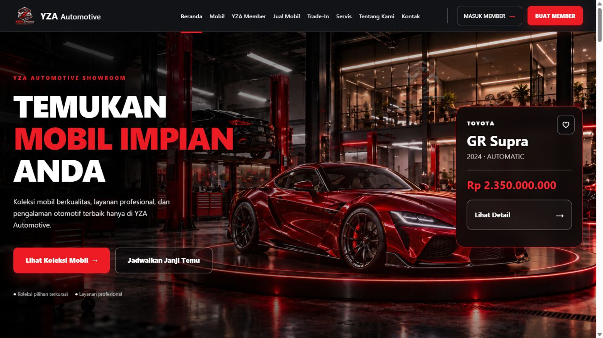
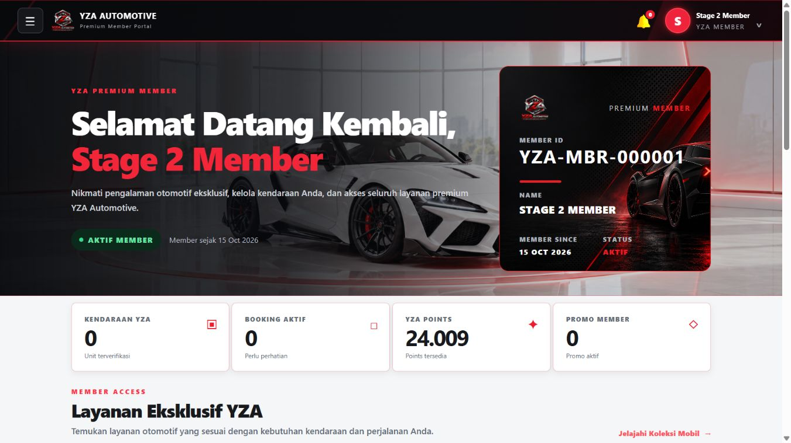

# YZA Automotive — Global Responsive 100% Report

Tanggal finalisasi: **6 November 2026, Asia/Jakarta**. Project: `C:\xampp\htdocs\yza_automotive_laravel`.

## 1. Executive Summary

**Status akhir: IMPLEMENTED — VISUAL NOT VERIFIED untuk keseluruhan website.** Implementasi responsif yang sudah ada dipertahankan. Build dan pengujian yang diizinkan selesai; persetujuan visual seluruh halaman belum dapat diberikan. Browser zoom 100% tetap baseline, terutama viewport 1366×768. Tidak ditambahkan CSS zoom, transform scale global, atau pembatas zoom pengguna.

Foundation mencakup shell publik/member/backoffice/Owner, grid, navbar/drawer, tabel, form, modal, footer, fokus keyboard dan reduced motion. Branding serta gambar hero tetap dipertahankan. Finalisasi ini tidak mengubah controller/service, permission, pembayaran, membership, promo, QC/PDI, WO, stok, invoice, atau handover.

Validasi ulang: frontend build berhasil; focused tests **10/75 assertion**; render coverage **1/4 assertion** tanpa respons 500/exception; full regression **583/2.672 assertion**, **0 failure/error/skipped**. Angka focused merupakan subset suite penuh, sedangkan tes render dijalankan terpisah; jangan menjumlahkannya sebagai peningkatan baseline full suite.

Bukti terdahulu mencakup **657 kombinasi role–halaman dari 175 route UI unik**, diukur pada 320×568 dan 1366×768, bukan 657 halaman unik yang lulus visual. Matriks viewport lengkap, zoom browser nyata, modal, dropdown, grafik dan seluruh alur form masih memerlukan UAT. Laporan ini menyelesaikan pekerjaan finalisasi/dokumentasi yang diizinkan, bukan menyatakan visual seluruh aplikasi selesai.

## 2. Status Git dan working tree

| Item | Hasil |
|---|---|
| Branch | `feature/vehicle-purchase-flow` |
| HEAD | `0359b1e8fa28aeceac5aa8491bb7eb5d85672ea6` |
| Working tree | Sudah berisi banyak perubahan lokal sebelum pekerjaan responsif; tetap dipertahankan |
| Snapshot status | [git-status-final.txt](responsive-100/git-status-final.txt) |
| Operasi Git destruktif | Tidak dijalankan |
| Commit/push/deploy | Tidak dilakukan |

Diff terhadap HEAD mencakup pekerjaan P0 dan pengembangan sebelumnya. Seluruh file dirty dalam snapshot Git **bukan** daftar perubahan baru finalisasi ini. Tidak ada baseline bersih yang dipakai untuk menimpa source.

## 3. Daftar file dalam cakupan perubahan responsif

Daftar berikut merupakan jejak implementasi responsif lintas sesi, bukan klaim bahwa seluruh isi setiap file dibuat pada tahap ini. Perubahan baru finalisasi dibatasi pada assertion tes render dan artefak QA.

| File | Perubahan responsif yang relevan |
|---|---|
| `public/assets/css/responsive-foundation.css` | Tokens, lebar shell, grid intrinsik, typography fluid, nav/drawer, form/table/modal, footer, perbaikan template spesifik |
| `public/assets/js/responsive-foundation.js` | Scroll tabel lokal, akses CTA akun pada menu publik, Escape/fokus drawer, bantuan keyboard modal |
| `public/assets/js/owner-executive.js` | Menyamakan breakpoint drawer Owner dengan CSS 1024 px |
| `resources/views/components/responsive-foundation.blade.php` | Include CSS/JS dengan versi asset |
| `resources/views/layouts/app.blade.php` | Foundation setelah stylesheet area; breakpoint desktop admin 1025 px |
| `resources/views/public/home.blade.php` | Include foundation |
| `resources/views/mobil/show.blade.php` | Include foundation pada root HTML terpisah |
| `resources/views/auth/login.blade.php` | Include foundation |
| `resources/views/auth/register.blade.php` | Include foundation |
| `resources/views/pelanggan/membership/activation.blade.php` | Include foundation |
| `resources/views/admin/mobil/index.blade.php` | Helper thumbnail menjadi closure lokal agar render berulang tidak mendeklarasikan fungsi global lagi |
| `resources/views/pelanggan/kendaraan/_form.blade.php` | Tombol Batal pada kendaraan baru kembali ke index, tidak membentuk URL detail tanpa ID |
| `tests/Ui/ResponsiveRenderCoverageTest.php` | Export GET berotorisasi di database test, inventaris, cleanup output buffer; finalisasi menambahkan assertion tanpa server error |
| `tests/Support/responsive_preview_router.php` | Preview statis read-only untuk QA terdahulu; tidak bootstrap aplikasi/database |

Artefak finalisasi: laporan ini, [manual UAT](responsive-100/MANUAL_UAT_CHECKLIST.md), tiga CSV coverage, [ringkasan bukti dan hash](responsive-100/evidence-summary.json), log build/tes final dan XML JUnit. `public/build` dihasilkan ulang oleh Vite; bukan deploy. Hash mencatat source saat finalisasi, bukan membuktikan screenshot lama memakai source akhir yang identik.

## 4. Masalah responsif sebelum perbaikan

Audit menemukan beberapa akar masalah yang sesuai screenshot awal pengguna pada zoom 67%:

- Navbar member memiliki header 86 px, label/menu besar dan banyak item, sedangkan breakpoint compact terlalu sempit; pada laptop menu bertabrakan dengan logo.
- Sidebar/grid backoffice dan scroll utama mengandalkan ukuran viewport tetap; ruang konten laptop berkurang dan footer sulit diprediksi.
- Kicker KPI admin bertabrakan dengan ikon ketika lima kartu berada pada satu baris.
- Grid checkout memiliki minimum kolom tetap; grid katalog member memakai pelebaran dan margin negatif.
- Footer member memiliki minimum 390 px dan teks nowrap; halaman melebar pada ponsel 320 px.
- Banner pembayaran/booking/servis memiliki minimum 320 px di dalam kontainer yang lebih sempit.
- Header stok masuk, detail sparepart, stepper trade-in, dan nominal KPI laporan servis tidak membungkus dengan aman.
- CSS terdiri dari beberapa lapisan override, termasuk inline stylesheet. Root HTML publik/auth/detail tidak semuanya memakai layout bersama.
- Render lintas halaman mengungkap helper fungsi global thumbnail yang dideklarasikan ulang dan tautan Batal form kendaraan baru yang membutuhkan ID yang belum ada.

Layout yang ditemukan: `layouts.app` dengan cabang member, admin, Owner dan fallback petugas/publik; root publik `public.home`; root detail mobil; login/register; aktivasi membership. `welcome.blade.php` bukan landing aktif. Export/print Owner memiliki kebutuhan layout tersendiri dan tidak dianggap sama dengan UI layar. Inventaris lengkap berisi **201 Blade view dan 246 GET route**, termasuk partial, framework route, export dan endpoint non-HTML.

## 5. Masalah yang diperbaiki dan tingkat buktinya

| Perbaikan | Bukti aktual / batas verifikasi |
|---|---|
| Navbar member compact, drawer dan header sticky proporsional | Screenshot dashboard 1366 diperiksa; visual akhir semua halaman/nav state belum diverifikasi |
| Sidebar admin 15rem, rail collapse, drawer ≤1024; konten natural scroll | Dashboard desktop/mobile pernah diamati; buka/Escape drawer dan fokus kembali pernah diuji; collapse lintas ukuran belum lengkap |
| KPI admin dan hero lebih proporsional | Screenshot dashboard setelah koreksi diamati di sesi sebelumnya, tetapi file after admin tidak tersimpan |
| Footer member, banner minimum, action group stok masuk, detail sparepart, stepper trade-in | 41 dari 45 render yang bermasalah lolos pengukuran ulang 320 px yang tersimpan |
| Nominal KPI laporan servis membungkus | CSS diperbaiki setelah empat hasil recheck masih overflow; observasi DOM sesudah reload menunjukkan scrollWidth 305 pada viewport 320, namun hasil akhir itu tidak disimpan sebagai JSON/screenshot |
| Katalog member mengikuti kontainer | CSS diperbaiki setelah satu overflow laptop; observasi DOM sesudah reload menunjukkan scrollWidth 1351 pada viewport 1366, namun hasil akhir itu tidak disimpan sebagai JSON/screenshot |
| Checkout/form/table/modal primitives | Implementasi tersedia; tidak disimpulkan lulus seluruh state dari inspeksi CSS |
| Helper thumbnail closure dan Batal tambah kendaraan | Render ulang tanpa 500/exception; belum merupakan bukti interaksi UI end-to-end |

Tabel/form mempertahankan field dan aksi yang ada. Tabel lebar mendapat scroll lokal; tidak ditambahkan `overflow-x:hidden` pada body untuk menutupi masalah. Foundation menjaga `min-width:0`, ukuran input, max-height modal dan fokus keyboard. Aksesibilitas menyeluruh tetap perlu pengujian interaksi dan screen reader; inspeksi implementasi bukan sertifikasi aksesibilitas.

## 6. Daftar halaman yang diuji

Daftar lengkap bersifat machine-readable agar setiap role/route dapat ditelusuri:

- [ui-page-coverage.csv](responsive-100/ui-page-coverage.csv): **657 baris**, masing-masing role, route, URI, file HTML, hasil render, lebar DOM historis dan status visual akhir.
- [route-attempts.csv](responsive-100/route-attempts.csv): seluruh **2.636 kombinasi percobaan**, termasuk redirect, denial, 404 dan fixture tidak tersedia.
- [routes-without-html-coverage.csv](responsive-100/routes-without-html-coverage.csv): **71 GET route** tanpa HTML coverage; termasuk route non-UI/dikecualikan. Bukan berarti semuanya halaman UI rusak.
- [render-inventory.json](responsive-100/render-inventory.json): 246 GET route beserta middleware/action, seluruh view dan hasil tiap role.

Cakupan mencakup landing, login/register, katalog/detail mobil yang tersedia; dashboard, katalog, garage/create, pesanan, booking, trade-in, promo/poin member yang dapat dirender; dashboard, list/create/edit/detail/laporan/data master/operasi admin dan role lain sesuai fixture/otorisasi. Detail yang kekurangan fixture tidak dihitung sudah teruji.

## 7. Penjelasan 657 render terdahulu

Metodenya terdiri dari lapisan berbeda:

1. **Laravel HTTP render:** test melakukan GET dengan user per role dan middleware asli. Seeder staff serta assignment fixture berada di transaksi database testing yang di-rollback. HTTP 200 HTML diekspor. Tidak ada login atau data operasional yang diubah.
2. **Browser DOM:** HTML hasil render dibuka di preview statis lokal read-only pada sesi sebelumnya, menggunakan asset CSS/JS aplikasi. Sebanyak 657 kombinasi diukur pada masing-masing 320×568 dan 1366×768. Ini bukan 657 live authenticated E2E flows.
3. **Screenshot visual:** beberapa dashboard/landing diamati; hanya lima file before/after tersimpan. Melihat `scrollWidth` tidak membuktikan tidak ada overlap, clipping, fokus rusak atau tombol sulit dipakai.
4. **Interaksi browser:** intro publik dan drawer admin diuji secara terbatas. Tidak mencakup submit form, checkout, pembayaran, semua dropdown atau modal.

Hasil HTTP final: **660 respons 200** (657 HTML dan tiga non-HTML), **18 redirect 302**, **1.689 respons 403**, **25 respons 404**, **244 kombinasi fixture-unavailable**, **0 server error/exception**. Respons 403 dipertahankan sesuai backend; tidak ada permission dilonggarkan. Assertion tanpa 500 tidak menyatakan seluruh 404 adalah hasil yang benar.

Nama file HTML menggabungkan role dan route. Ada **175 route UI unik** di antara 657 HTML. Role yang berbeda dapat memakai template dan URI yang sama. Pengukuran DOM tersimpan: **1.314 observasi awal + 45 recheck ponsel**, bukan 1.359 halaman unik.

## 8. Matriks viewport dan role

Klasifikasi yang dipakai: `VERIFIED PASS` hanya untuk pengujian spesifik yang benar-benar dijalankan; `IMPLEMENTED — VISUAL NOT VERIFIED` untuk implementasi yang belum mendapat persetujuan visual akhir; `NEEDS FIX` untuk masalah terbukti yang belum diperbaiki; `BLOCKED` untuk metode yang terhalang; `NOT TESTED` untuk cakupan yang belum diuji.

| Viewport | Bukti tersimpan | Status visual akhir |
|---|---|---|
| 320×568 | 657 pengukuran DOM awal; 45 recheck; member/admin/Owner pernah diamati | IMPLEMENTED — VISUAL NOT VERIFIED |
| 375×720 | Tidak ada matriks/bukti selesai | NOT TESTED |
| 390×768 | Tidak ada matriks/bukti selesai | NOT TESTED |
| 430×900 | Tidak ada matriks/bukti selesai | NOT TESTED |
| 768×900 | Tidak ada matriks/bukti selesai | NOT TESTED |
| 1024×768 | Tidak ada matriks/bukti selesai | NOT TESTED |
| 1280×720 | Tidak ada matriks/bukti selesai | NOT TESTED |
| 1366×768 | 657 pengukuran DOM; before/after publik/member, before admin | IMPLEMENTED — VISUAL NOT VERIFIED untuk keseluruhan |
| 1440×900 | Tidak ada matriks/bukti selesai | NOT TESTED |
| 1920×1080 | Screenshot pengguna awal pada zoom 67% bukan bukti implementasi 100% | NOT TESTED |
| 2560×1080 | Tidak ada matriks/bukti selesai | NOT TESTED |
| Zoom nyata 125/150/200% | Tidak berhasil dijalankan; resize viewport tidak dianggap setara bukti zoom nyata | BLOCKED untuk browser QA; UAT diperlukan |

Matriks role berikut menunjukkan jumlah HTML yang dirender dan diukur, bukan jumlah halaman visual PASS.

| Role/Area | Kombinasi HTML | Desktop 1366/100% | Tablet | Mobile 320 | Zoom 200% | Status akhir |
|---|---:|---|---|---|---|---|
| Public | 5 | DOM + screenshot landing historis | NOT TESTED | DOM | BLOCKED | IMPLEMENTED — VISUAL NOT VERIFIED |
| Member/pelanggan | 28 | DOM + screenshot dashboard historis | NOT TESTED | DOM + observasi dashboard | BLOCKED | IMPLEMENTED — VISUAL NOT VERIFIED |
| Admin | 141 | DOM | NOT TESTED | DOM | BLOCKED | IMPLEMENTED — VISUAL NOT VERIFIED |
| Super Admin | 141 | DOM + observasi dashboard | NOT TESTED | DOM + drawer terbatas | BLOCKED | IMPLEMENTED — VISUAL NOT VERIFIED |
| Owner | 92 | DOM | NOT TESTED | DOM + observasi dashboard | BLOCKED | IMPLEMENTED — VISUAL NOT VERIFIED |
| Sales | 37 | DOM | NOT TESTED | DOM | BLOCKED | IMPLEMENTED — VISUAL NOT VERIFIED |
| Service Advisor | 36 | DOM | NOT TESTED | DOM | BLOCKED | IMPLEMENTED — VISUAL NOT VERIFIED |
| Mechanic | 42 | DOM | NOT TESTED | DOM | BLOCKED | IMPLEMENTED — VISUAL NOT VERIFIED |
| Warehouse Staff | 26 | DOM | NOT TESTED | DOM | BLOCKED | IMPLEMENTED — VISUAL NOT VERIFIED |
| Finance | 23 | DOM | NOT TESTED | DOM | BLOCKED | IMPLEMENTED — VISUAL NOT VERIFIED |
| Operational Staff | 20 | DOM | NOT TESTED | DOM | BLOCKED | IMPLEMENTED — VISUAL NOT VERIFIED |
| Quality Control | 22 | DOM | NOT TESTED | DOM | BLOCKED | IMPLEMENTED — VISUAL NOT VERIFIED |
| Petugas legacy | 44 | DOM | NOT TESTED | DOM | BLOCKED | IMPLEMENTED — VISUAL NOT VERIFIED |

Setiap halaman dan role tercantum terpisah dalam CSV. Tidak ada role di tabel yang sepenuhnya belum dirender; semua role masih memerlukan UAT visual lintas ukuran dan interaksi.

## 9. Pemeriksaan browser yang benar-benar dilakukan

Sesi terdahulu memakai in-app browser dan preview HTML statis pada `127.0.0.1:8011`. Server preview tidak bootstrap Laravel, tidak membuka database, dan bukan aplikasi operasional yang diberi auth bypass. Bukti tersebut dipertahankan sebagai **bukti historis**, bukan origin yang diotorisasi untuk automation baru pada finalisasi ini.

Yang diamati: landing desktop dan penutupan intro; dashboard member desktop/mobile; admin desktop/mobile dan koreksi KPI; drawer admin buka, tombol tutup, Escape serta fokus kembali ke pemicu; Owner dashboard mobile. Yang tidak terbukti lengkap: semua link/menu, collapse/resizing, klik luar setiap drawer, focus trap setiap modal, dropdown/notifikasi/profil, chart resize, validasi form, checkout dan alur transaksi UI.

Pengambilan screenshot kemudian gagal, tab in-app baru tidak dapat attach, dan fallback Computer Use Edge dihentikan otomatis karena URL tidak dapat dipastikan dengan cukup yakin untuk pemeriksaan keamanan. **Tidak ada pemeriksaan keamanan yang dilewati.** Finalisasi menggunakan jalur render/statis dan checklist manual yang diminta pengguna; tidak meneruskan automation Edge atau membuka ulang origin preview. Automation berikutnya hanya boleh memakai `http://127.0.0.1:8000` setelah aplikasi/origin dapat diverifikasi dengan aman.

Observasi layar historis tidak otomatis mengesahkan source final: beberapa perbaikan dilakukan sesudah capture dan belum memiliki screenshot ulang. Kegagalan capture pada awal loop matriks berarti loop tersebut tidak dihitung selesai; tidak ada file matriks 44 kombinasi yang dapat dijadikan bukti.

## 10. Pemeriksaan statis dan render

| Pemeriksaan | Hasil terukur | Batas hasil |
|---|---|---|
| Laravel isolated render final | VERIFIED PASS: 1 test, 4 assertions; 0 failure/error/skipped; 0 respons ≥500/exception | Fixture/404/redirect/403 tetap harus ditriase; bukan visual PASS |
| Focused navigation/Owner | VERIFIED PASS: 10 tests, 75 assertions | HTTP/backend assertions, bukan interaksi browser |
| DOM awal 320 | 657 observasi, 45 overflow pada 10 route unik | Dilakukan sebelum rangkaian perbaikan terakhir |
| DOM recheck 320 | 45 observasi, 41 tidak lagi overflow; 4 laporan servis masih overflow saat JSON disimpan | Empat hasil itu mendahului perbaikan nominal KPI |
| DOM awal 1366 | 657 observasi, satu overflow katalog member | Mendahului perbaikan katalog terakhir |
| Node syntax | VERIFIED PASS untuk foundation JS dan Owner JS | Bukan perilaku runtime penuh |
| PHP syntax | VERIFIED PASS untuk exporter dan preview router | Blade diuji melalui render, bukan menganggap php-lint cukup |
| `git diff --check` | VERIFIED PASS, exit 0; ada pemberitahuan normalisasi CRLF/LF | Bukan pemeriksaan visual |
| Foundation inclusion | Terpasang pada layout app dan lima root HTML terpisah | Inline stylesheet masih dapat memengaruhi template tertentu |
| Larangan scaling | Tidak ditemukan deklarasi zoom/global scale/user-scalable pada file foundation baru | Transform komponen/asset existing tidak disamakan dengan scaling seluruh aplikasi |

Bukti DOM mentah: [awal 320](responsive-100/dom-initial-320.json), [recheck 320](responsive-100/dom-recheck-320.json), [awal 1366](responsive-100/dom-initial-1366.json). Data mentah sengaja tidak diedit menjadi PASS setelah source diperbaiki.

Tes memakai `APP_ENV=testing`, database **`yza_automotive_laravel_test`**, cache/session array dan queue sync; exporter memverifikasi environment dan nama database sebelum seed fixture. Tidak ada migration destruktif, perubahan credential atau koneksi ke database operasional untuk penulisan. Tidak dilakukan snapshot/checksum database operasional sebelum/sesudah; laporan tidak mengklaim bukti checksum yang tidak ada.

## 11. Hasil frontend build

**VERIFIED PASS — `npm run build`**, Vite berhasil dalam 6,01 detik pada finalisasi. Asset: CSS 54,80 kB (gzip 11,40 kB), JS 51,52 kB (gzip 19,51 kB), manifest 0,33 kB. Tidak menambah dependency/library berat.

Log: [frontend-build-final.log](responsive-100/frontend-build-final.log). Foundation berupa asset publik terpisah (sekitar 24,6 kB CSS dan 5,5 kB JS sebelum kompresi), sehingga keberhasilan Vite tidak dianggap sebagai validasi sintaks/perilaku semua aturan foundation. Pemeriksaan syntax dan render dijalankan terpisah. Tidak dilakukan benchmark mobile jaringan/CLS; hasil performa tersebut NOT TESTED.

## 12. Hasil regression

**VERIFIED PASS — 583 tests, 2.672 assertions, 0 failures, 0 errors, 0 skipped.** Full suite final selesai dalam 1 menit 23,415 detik pada database testing terisolasi. Tidak ada tes lama yang dihapus atau assertion lama dilemahkan.

| Run | Hasil | Bukti |
|---|---|---|
| Full regression final | 583 / 2.672 assertions | [JUnit](YZA_RESPONSIVE_FULL_FINAL.xml), [log](responsive-100/full-regression-final.log) |
| Focused AdminWorkspaceNavigation + OwnerDashboardRedesign | 10 / 75 assertions | [JUnit](YZA_RESPONSIVE_FOCUSED_FINAL.xml), [log](responsive-100/focused-final.log) |
| Responsive GET render final | 1 / 4 assertions | [JUnit](YZA_RESPONSIVE_RENDER_FINAL.xml), [log](responsive-100/render-final.log) |

Kelulusan suite menjaga baseline P0 Stage 1–4 pada scope assertion yang ada. Ini tidak menggantikan UAT visual dan tidak dianggap pengujian pembayaran pihak ketiga yang baru.

## 13. Screenshot before/after

File berikut benar-benar tersedia dan telah diperiksa. Ukuran capture 1366×768; gambar menunjukkan data fixture, bukan akun operasional. Before/after berasal dari sesi implementasi sebelumnya. Lima gambar tidak membuktikan seluruh 175 route lulus.

| Area | Before | After | Cakupan |
|---|---|---|---|
| Public landing | [before-public-1366.png](responsive-100/screenshots/before-public-1366.png) | [after-public-1366.png](responsive-100/screenshots/after-public-1366.png) | Hero/navbar viewport awal saja |
| Member dashboard | [before-member-1366.png](responsive-100/screenshots/before-member-1366.png) | [after-member-1366.png](responsive-100/screenshots/after-member-1366.png) | Header, greeting, kartu member, empat KPI |
| Admin dashboard | [before-admin-1366.png](responsive-100/screenshots/before-admin-1366.png) | Tidak tersimpan | After pernah diamati, belum memiliki artefak file |

Tidak ada screenshot tablet, zoom nyata 200%, modal panjang atau full-page setelah perbaikan terakhir yang dapat dinyatakan selesai. Daftar capture yang dibutuhkan ada di checklist UAT.

## 14. Masalah dan risiko tersisa

Tidak ada bug visual baru yang dinyatakan pasti selesai tanpa bukti. Isu berikut masih terbuka untuk verifikasi:

| Item | Klasifikasi | Tindak lanjut |
|---|---|---|
| Browser visual automation dan zoom nyata | BLOCKED | Gunakan pemeriksaan origin aman atau manual UAT |
| Empat recheck laporan servis 320 masih overflow dalam JSON historis | IMPLEMENTED — VISUAL NOT VERIFIED | Retest sesudah perbaikan wrap nominal; simpan hasil akhir |
| Satu overflow katalog member 1366 dalam JSON historis | IMPLEMENTED — VISUAL NOT VERIFIED | Retest sesudah width/margin correction; simpan hasil akhir |
| Modal, dropdown, chart, footer akhir, form error dan target sentuh seluruh role | IMPLEMENTED — VISUAL NOT VERIFIED | Uji interaksi/state dan seluruh ukuran matriks |
| 25 respons 404 pada 10 nama route | NOT TESTED untuk UI tujuan | Triage fixture/lifecycle/query; jangan menganggap semua sebagai bug atau semua sebagai hasil benar |
| 244 kombinasi kekurangan fixture, 46 nama route | NOT TESTED | Siapkan data test sesuai ownership/assignment/lifecycle |
| Route export/download/search/non-HTML yang dikecualikan | NOT TESTED pada visual UI | Bedakan yang memang bukan UI, lalu uji print/export yang relevan |
| Source akhir belum mempunyai visual snapshot menyeluruh | IMPLEMENTED — VISUAL NOT VERIFIED | Lengkapi bukti sesuai CSV sebelum final visual sign-off |

Tidak ada klaim **NEEDS FIX** baru yang didasarkan hanya pada ketidaktersediaan fixture. Bila UAT mereproduksi bug yang masih ada pada source akhir, ubah status menjadi NEEDS FIX dengan langkah reproduksi dan bukti.

## 15. Halaman yang masih memerlukan manual UAT

**Seluruh 175 route UI yang ter-render tetap membutuhkan final visual sign-off**, termasuk halaman yang mempunyai DOM tanpa overflow. Prioritas: empat halaman kritis, katalog/detail/checkout/garage member, form create/edit, semua lifecycle WO/QC/PDI/handover, finance/invoice, laporan, modal, grafik dan setiap role.

Route yang menghasilkan 404 meliputi: `admin.used-car.payment.create`, `admin.car-sale.payment.create`, `admin.invoice.car-sale`, varian petugas tiga route tersebut, `pelanggan.preorder.create`, `pelanggan.booking.create`, `pelanggan.test-drive.create`, dan `pelanggan.invoice.car-sale`. Parameter/fixture yang dipilih exporter tidak membuktikan keadaan transaksi eligible tersedia.

Fixture tidak tersedia antara lain showcase publik/member; leads Sales detail; pesanan/promo/garage detail/edit member; pengajuan, booking servis/cuci, riwayat/tracking/persetujuan servis; detail WO pemeriksaan–finalisasi; data master jenis servis/paket cuci; promo simulation/analytics; stok masuk detail dan invoice used-car. Daftar lengkap per role dan URI berada dalam CSV, bukan diasumsikan lulus.

Checklist lengkap: **[MANUAL_UAT_CHECKLIST.md](responsive-100/MANUAL_UAT_CHECKLIST.md)**. Checklist mencakup seluruh ukuran, zoom nyata, semua role, form/tabel/detail/transaksi, navigasi, modal/chart, bukti screenshot, syarat lingkungan test dan kriteria keputusan akhir. Semua kotak awal sengaja belum dicentang.

## 16. Final responsive readiness status

**Build/render/regression: VERIFIED PASS pada cakupan pengujian yang dijelaskan. Keseluruhan responsive UI: IMPLEMENTED — VISUAL NOT VERIFIED.** Browser QA berstatus BLOCKED dan ukuran/state tanpa bukti berstatus NOT TESTED; tidak diberi label PASS secara tersirat.

Laporan, inventaris dan checklist finalisasi sudah disiapkan. Implementasi terdahulu tetap dipertahankan, tanpa perubahan bisnis atau database operasional, tanpa commit/push/deployment. Sebelum final visual approval, lengkapi screenshot dan interaksi manual, retest dua koreksi terakhir, triage 404 serta fixture yang hilang, dan tutup setiap NEEDS FIX yang muncul. Pekerjaan finalisasi berhenti setelah laporan dan pengujian yang diizinkan selesai, sesuai permintaan pengguna.
